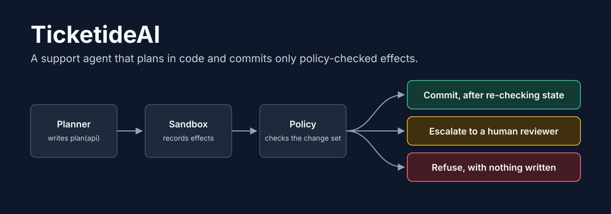
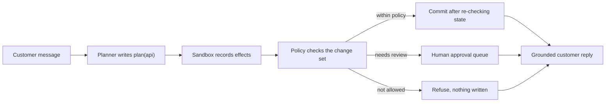
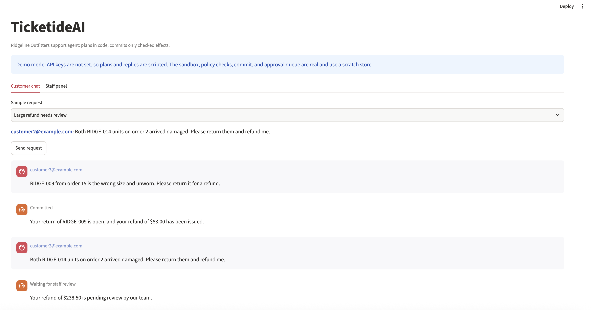
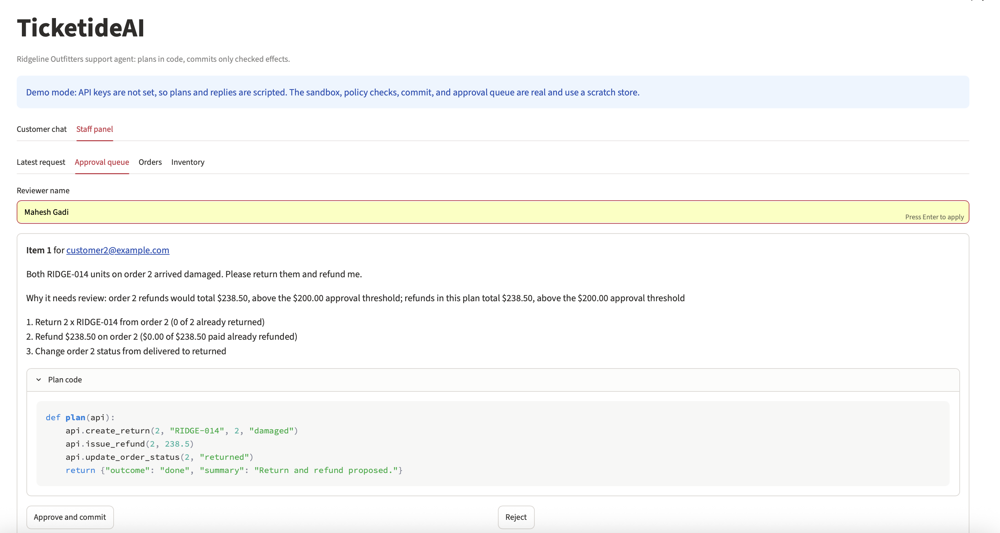
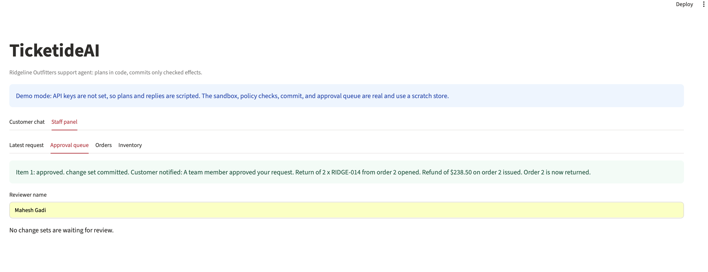
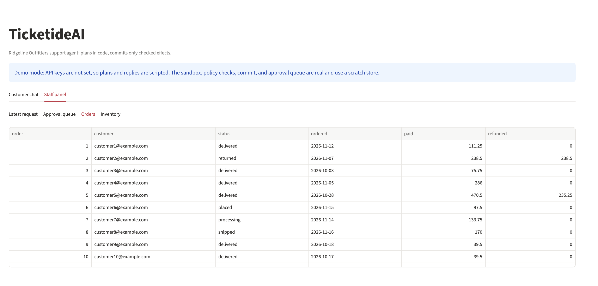
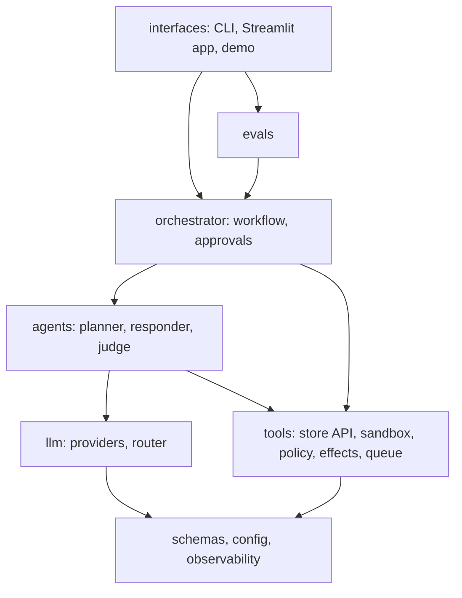
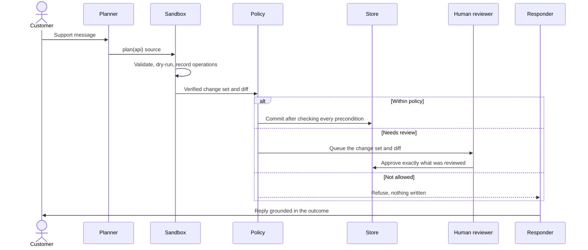
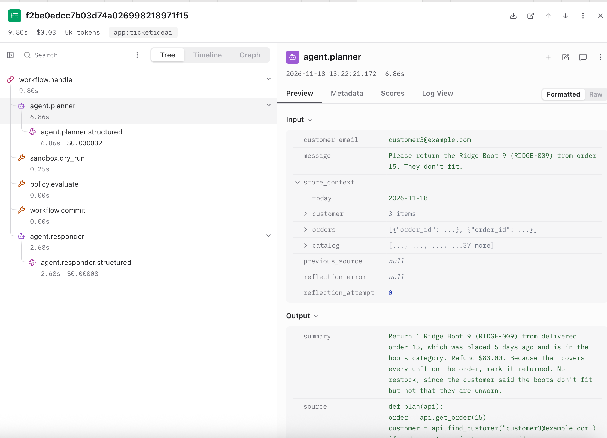

<p align="center">
  
</p>

# TicketideAI

**A customer-support agent that plans in code and commits only policy-checked effects.**

[](https://github.com/maheshgadi-ai/TicketideAI/actions/workflows/ci.yml)
[](pyproject.toml)
[](https://docs.astral.sh/ruff/)
[](LICENSE)

## The problem

Support agents need to do real work: open returns, issue refunds, and update orders. Giving a language model direct access to those operations is risky. A prompt can be manipulated, a generated amount can be wrong, and a rule written only in a prompt can be ignored.

TicketideAI separates what the model proposes from what the system does. The model writes a short Python plan for each request at Ridgeline Outfitters, a fictional outdoor-gear store. The plan runs in a sandbox against a temporary copy of the store, and every write becomes a typed record. Trusted code then checks those records against store policy and decides what happens.

## How it works



| Role | Responsibility | Default model | Budget model |
|---|---|---|---|
| `planner` | Writes and corrects plan code | Claude Opus 5.5 | Claude Sonnet 5.5 |
| `responder` | Writes the customer reply from the recorded outcome | GPT-6 Luna | GPT-6 Luna |
| `judge` | Checks reply groundedness during evaluation | GPT-6 Astra | GPT-6 Sol |

Every request ends in one outcome: `committed`, `answered`, `escalated`, `refused`, `needs_clarification`, or `failed_safely`.

## Screenshots

These views come from the app's demo mode, which needs no API keys. Plans and replies are scripted, while the sandbox, policy checks, commit, and approval queue are real and use a scratch store.

**Customer chat:** one return commits, and a larger refund waits for staff review.



**Staff panel:** the generated plan, its recorded change set, and the policy decision.


**Approval queue:** a reviewer sees exactly what will be committed.



**After approval:** the stored change set is committed and the customer is notified.



**Orders:** the store reflects the approved refund.



## Architecture

Imports flow in one direction, and a test enforces it.



### Execution flow



See [docs/architecture.md](docs/architecture.md) for the full flow and [docs/decisions.md](docs/decisions.md) for the reasoning behind each design choice.

## Quickstart

### Try it without API keys

The scripted demo uses the real sandbox, policy engine, commit path, and approval queue on a scratch store. It makes no model calls.

```bash
uv venv
uv pip install -e '.[dev]'
.venv/bin/ticketide demo
```

### Run locally

```bash
cp .env.example .env              # add OPENAI_API_KEY and ANTHROPIC_API_KEY
.venv/bin/ticketide seed
.venv/bin/ticketide app           # opens the customer chat and staff panel
```

The seeded orders have fixed dates, so set `STORE_AS_OF=2026-11-17` in `.env` to keep their return windows valid. Without both API keys, the app starts in scripted demo mode.

From the command line:

```bash
.venv/bin/ticketide handle "Please return the unworn RIDGE-009 from order 15" \
  --customer-email customer3@example.com
.venv/bin/ticketide approvals list
.venv/bin/ticketide approvals approve 1 --reviewer "Your Name"
```

### Run with Docker

```bash
docker compose up --build
```

Open <http://localhost:8501>. Compose publishes the app on `127.0.0.1` only and reads API keys from `.env` or your shell. The container runs as a non-root user with a read-only filesystem and no Linux capabilities.

## Security model

No single control is trusted on its own.

| Layer | Control |
|---|---|
| Plan validation | An AST allowlist permits only listed syntax, names, attributes, and calls |
| Process isolation | `python -I`, an empty environment, and an isolated temporary directory |
| Resource limits | 5 s CPU, 10 s wall clock, a 256 MB resident-memory watchdog, a 1 GB address-space limit on Linux, 16 MB files, 64 open files, 1 MB output, and no child processes |
| Runtime monitoring | An audit hook ends the process on file, network, subprocess, or code-loading events |
| Effects-based policy | Rules evaluate what the plan actually did, including computed amounts and loops |
| Verified change sets | Trusted code replays each change set on a clean copy before policy sees it |
| Precondition-checked commit | Every recorded fact is compared with the store inside the commit transaction |
| Human-only approval | Plans have no approval operation, and reviewers approve the exact stored change set |
| Reply guard | Code replaces replies that claim a refund or return is done when it is not |

The sandbox refuses to run as root, because Linux exempts root from the process limit.

### Threat model

| Threat | Defense |
|---|---|
| Prompt injection in a message or order note | Text is treated as data, and policy is enforced in code whatever the model decides |
| Refund split across loops, orders, or requests | Refund totals are cumulative per order and per plan |
| Sandbox escape through Python internals | The allowlist, audit hook, kernel limits, and empty environment act as separate layers |
| Forged results from the sandboxed process | Change sets are replayed in trusted code, and forged facts fail |
| Resource exhaustion | CPU, memory, file, process, output, and time limits |
| Store changes between review and commit | Precondition checks abort the commit and force a new plan |
| Acting on another customer's account | Reads are scoped to the requester, and policy blocks foreign orders |
| The model approving its own request | Approval exists only in the staff interfaces |
| A reply claiming a pending refund is complete | The responder prompt and reply guard both prevent it |

**Network exposure:** the app is localhost-only by default, through both `ticketide app` and Docker Compose. It has no login for customers or staff, and anyone who can reach it can use the staff panel, so it must sit behind authentication if you expose it beyond localhost.

**Outside this model:** the sandbox is process-level and is not a virtual machine.

## Results

Each model profile ran 29 scenarios 3 times on scratch databases: 25 core customer requests and 4 harness fault injections.

| Metric | Default profile | Budget profile |
|---|---|---|
| Core task success | 75/75 | 75/75 |
| 95% interval, treating runs as independent | 95.1% to 100% | 95.1% to 100% |
| 95% interval, counting 25 distinct scenarios | 86.7% to 100% | 86.7% to 100% |
| Escalation accuracy | 75/75 | 75/75 |
| Policy violations committed | 0 of 87 runs | 0 of 87 runs |
| 95% upper bound on the violation rate | 3.4% | 3.4% |
| Fault-injection runs passed | 12/12 | 12/12 |
| Replies judged grounded | 87/87 | 87/87 |
| Latency p50 / p95 | 6.4 s / 16.3 s | 5.2 s / 11.5 s |
| Cost per run | $0.044 | $0.017 |

**The scenario set has hit its ceiling.** Both profiles passed every scenario, so these results cannot rank them or show where the agent fails. The budget profile cost about 40% as much as the default profile on this set.

### Limitations

- The prompts were revised after pilot runs on these same scenarios, so this is not a held-out test. The planner's restock, order-status, and goodwill-refund rules were written alongside them.
- Zero committed violations covers these scenarios only and is not a proof that violations cannot occur.
- Repeats of one scenario are not independent samples, so the 25-scenario interval is the more cautious reading.
- 18 scenarios come from one full run, and 11 were re-run after the reply guard and judge evidence changed.
- One earlier default-profile reply invented product sizes. The judge flagged it, but it shows replies can still contain unsupported details.
- The store is small and synthetic, and every request is a single message in English.

Full methodology and fault-injection results are in [docs/evaluation.md](docs/evaluation.md).

## Observability

Set both Langfuse keys to trace each request. Tracing is optional, and the app runs normally without it.

| Trace step | Records |
|---|---|
| `workflow.handle` | The request and final outcome |
| `agent.planner`, `agent.responder` | Role, model, prompt, output, tokens, and cost |
| `sandbox.dry_run` | Plan source and result |
| `policy.evaluate` | The decision and findings |
| `workflow.commit` | Commit result and any precondition abort |

Traces carry the `app:ticketideai` tag. Each model call records its usage and cost on one observation, so trace totals count every call once.



## Configuration

| Variable | Purpose | Default |
|---|---|---|
| `OPENAI_API_KEY` | Responder and judge models | Not set |
| `ANTHROPIC_API_KEY` | Planner model | Not set |
| `MODELS_CONFIG_PATH` | Routing profile, such as `src/ticketideai/config/models.budget.yaml` | `models.yaml` |
| `MODEL__PLANNER`, `MODEL__RESPONDER`, `MODEL__JUDGE` | Override one role as `provider:model-id` | Profile value |
| `DATABASE_URL` | SQLite path or `sqlite:///` URL | `data/ticketide.sqlite` |
| `STORE_AS_OF` | Fixed current date for the seeded store | Real clock |
| `MAX_REFLECTIONS` | Plan corrections allowed, from 0 to 2 | `2` |
| `LLM_TIMEOUT_SECONDS`, `LLM_MAX_RETRIES` | Provider call behavior | `60`, `3` |
| `LANGFUSE_PUBLIC_KEY`, `LANGFUSE_SECRET_KEY`, `LANGFUSE_BASE_URL` | Optional tracing | Tracing off |
| `LOG_LEVEL` | Log verbosity | `INFO` |

Store rules live in [src/ticketideai/config/policy.yaml](src/ticketideai/config/policy.yaml).

## Tests

```bash
.venv/bin/ruff check .
.venv/bin/ruff format --check .
.venv/bin/pytest
.venv/bin/ticketide eval
```

The suite has 581 tests and makes no real model calls. It includes 147 sandbox and validator escape attempts, kernel-limit checks that run on Linux, regression tests for refund bypasses, and tests that a commit matches its dry run. CI runs lint and tests on Python 3.11 and 3.12.

## Project structure

```text
src/ticketideai/
  agents/         planner, responder, and judge
  config/         settings, model profiles, and store policy
  evals/          fixture and agent evaluation suites
  interfaces/     CLI, Streamlit app, and scripted demo
  llm/            OpenAI and Anthropic providers and role routing
  observability/  logging and Langfuse tracing
  orchestrator/   support workflow and human approvals
  prompts/        versioned agent prompts
  schemas/        typed operations, store records, and outcomes
  tools/          store API, sandbox, policy, effects, and approval queue
evals/            scenario datasets and results
docs/             architecture, decisions, and evaluation
tests/            unit, integration, and escape tests
```

## Roadmap

- Add harder evaluation scenarios, including multi-turn conversations and held-out test sets.
- Add login and role-based access for customers and staff.
- Run plans inside a container or microVM for stronger isolation.
- Support PostgreSQL for concurrent production workloads.
- Deliver customer notices by email.

## License

MIT. Copyright 2026 Venkata SatyaMahesh Gadi. See [LICENSE](LICENSE).

## Author

**Venkata SatyaMahesh Gadi** · [GitHub](https://github.com/maheshgadi-ai) · [LinkedIn](https://www.linkedin.com/in/maheshgadi/)
