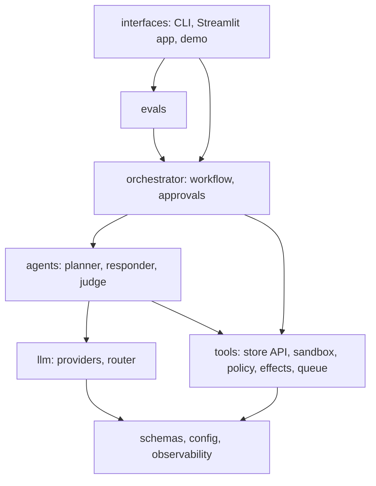
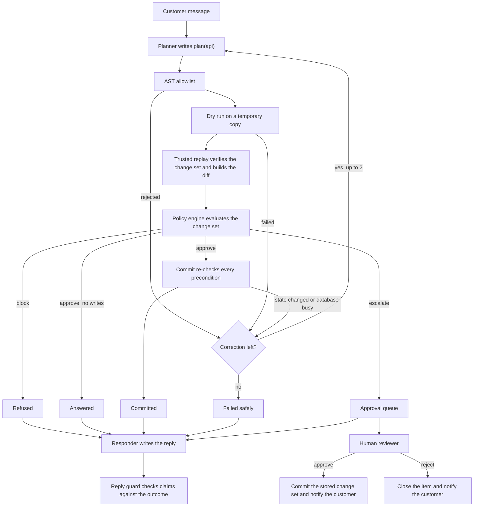

# Architecture

TicketideAI lets a model write a short Python plan, but a plan can never change the store. A plan only proposes effects. Trusted code checks those effects and applies them.

## Layers

Imports only flow downward, and `tests/test_architecture.py` enforces this.

## Execution flow

## Outcomes

| Outcome | Meaning | Store |
|---|---|---|
| `committed` | The change set passed policy and was applied | Changed |
| `answered` | The request only read data | Unchanged |
| `escalated` | The change set is waiting for a human reviewer | Unchanged until approved |
| `refused` | Policy blocked the request, or the planner declined it | Unchanged |
| `needs_clarification` | The agent needs more detail from the customer | Unchanged |
| `failed_safely` | Corrections ran out after errors or repeated state changes | Unchanged |

## Effects

Inside the sandbox, every write on `StoreAPI` is applied to a temporary database and recorded as a typed `Operation`. Each operation carries the facts it relied on, such as stock, order status, amount paid, and earlier refunds.

| Stage | Trusted code does |
|---|---|
| Dry run | Runs the plan in a child process and reads back the change set |
| Verification | Replays the change set on an untouched copy with the commit code path |
| Policy | Evaluates the operations and their facts |
| Commit | Takes the write lock, compares every recorded fact with the store, and applies the operations in one transaction |

Model code never runs outside the sandbox. The change set is data, so commit and approval apply exactly what was reviewed.

## Sandbox layers

1. The AST allowlist permits only listed syntax, names, attributes, and calls.
2. The child starts with `python -I`, an empty environment, and its own temporary working directory.
3. Kernel limits cap CPU time, address space, file size, open files, and child processes.
4. An audit hook ends the process on any file, network, subprocess, or code-loading event.
5. The parent enforces wall-clock, resident-memory, and output limits from outside the child.

The sandbox refuses to run as root, because Linux exempts root from the process limit.

Memory is enforced differently by platform. On Linux, the kernel's 1 GB address-space limit is the hard ceiling, and the parent's 256 MB resident-memory watchdog polls while the plan runs. macOS does not enforce the address-space limit, so the parent also checks the kernel's peak-memory record after the plan exits, which catches spikes shorter than a poll.
